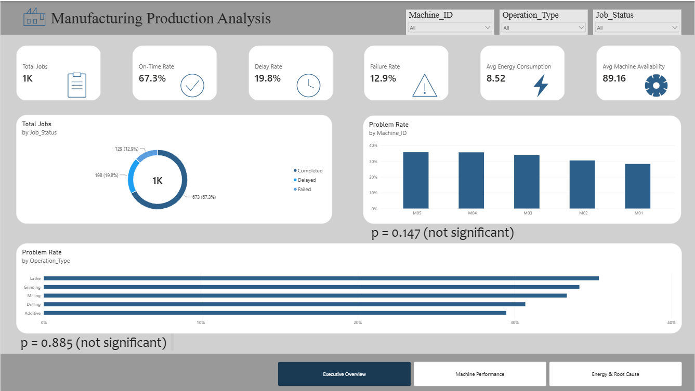
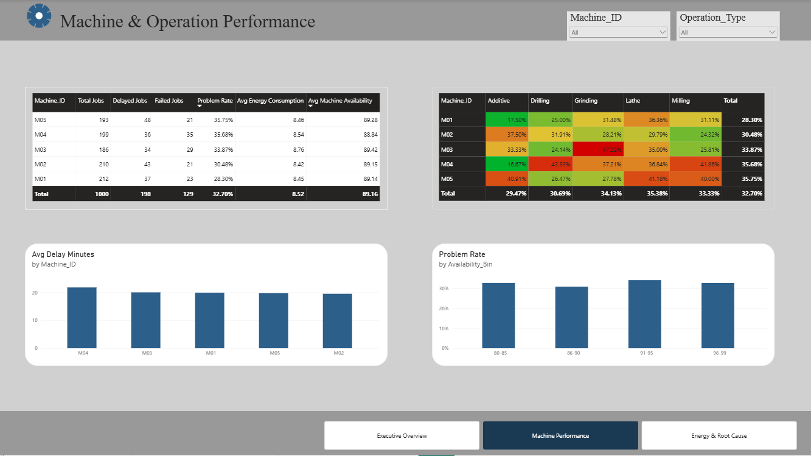
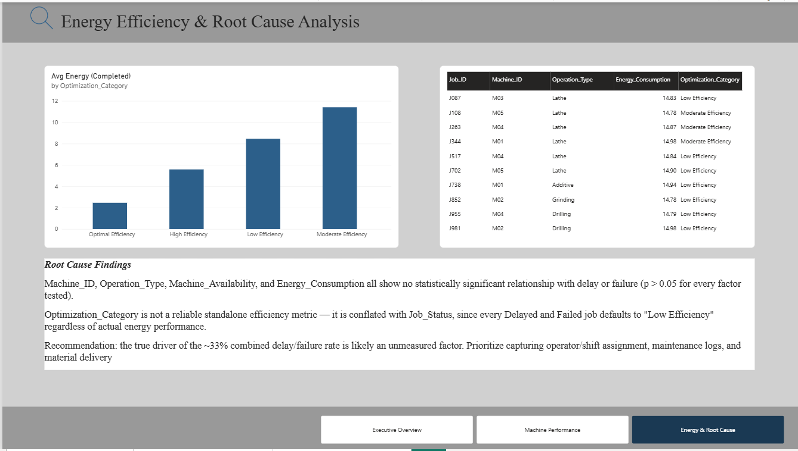

# Hybrid Manufacturing Production Analysis

Data analysis project investigating production delays, job failures, and energy efficiency across a manufacturing operation running five machines and five operation types.

## Business context

**Client brief:** Operations Manager at a manufacturing company operating multiple production machines. Recent months showed rising production delays and efficiency differences between machines. Management wanted to know whether the root cause was machine availability, processing time, energy consumption, operation type, or another factor — using a historical dataset of 1,000 production jobs recording scheduled and actual execution.

**Client's key instruction:** Do not assume the dataset's built-in `Optimization_Category` label is automatically correct. It had to be validated against actual performance before being used in any conclusion.

## Business questions answered

1. Which machine is most problematic?
2. Which operation type most often experiences delays or failures?
3. How large is the gap between scheduled and actual processing time?
4. Does machine availability relate to production delays?
5. Are any machines/operations using energy inefficiently?
6. What factors most plausibly cause production delay or job failure?
7. Which machine or process should be the improvement priority?

## Dataset

- 1,000 production jobs, 13 columns
- `Job_ID`, `Machine_ID`, `Operation_Type`, `Material_Used`, `Processing_Time`, `Energy_Consumption`, `Machine_Availability`, `Scheduled_Start`, `Scheduled_End`, `Actual_Start`, `Actual_End`, `Job_Status`, `Optimization_Category`
- 5 machines (M01–M05), 5 operation types (Additive, Drilling, Grinding, Lathe, Milling)
- Job outcomes: 67.3% Completed, 19.8% Delayed, 12.9% Failed

## Methodology

1. **Data cleaning & validation** — confirmed no duplicates and no invalid ranges; verified that missing `Actual_Start`/`Actual_End` values correspond exactly to `Failed` jobs (a structural property, not a data quality issue); confirmed `Processing_Time` equals scheduled duration.
2. **Exploratory data analysis** — production KPIs, distribution checks on all numeric fields.
3. **Delay analysis** — derived delay magnitude (`Actual_End - Scheduled_End`); confirmed status thresholds (Completed within ±5 min, Delayed 10–30 min late).
4. **Machine & operation performance** — chi-square tests of `Machine_ID` and `Operation_Type` against `Job_Status`.
5. **Energy efficiency validation** — cross-checked `Optimization_Category` against actual `Job_Status` and `Energy_Consumption` (ANOVA) to test whether the label is reliable.
6. **Root cause investigation** — t-tests of all continuous operational variables against delay/failure occurrence; checked for availability threshold effects and time trends.

## Key findings

- **No statistically significant driver found in the available data.** Machine identity (p=0.147), operation type (p=0.885), machine availability (p=0.782), energy consumption (p=0.959), and processing time (p=0.844) all show no significant relationship with delay or failure occurrence.
- Raw problem-rate differences between machines (e.g., M05 at 35.8% vs. M01 at 28.3%) fall within the range of random variation given the sample size per machine (~200 jobs).
- **`Optimization_Category` is not a reliable standalone efficiency metric.** Every `Delayed` and `Failed` job defaults to `Low Efficiency`, meaning the label conflates job outcome with energy performance. Among `Completed` jobs only, the category does correlate significantly with energy consumption (p<0.0001) but non-monotonically — `Moderate Efficiency` jobs consume more energy on average than `Low Efficiency` jobs.
- **Business implication:** the true driver of the ~33% combined delay/failure rate is likely an unmeasured factor — operator/shift assignment, upstream material delivery timing, maintenance events, or scheduling conflicts — none of which are captured in this dataset.

## Recommendations

1. Do not act on `Optimization_Category` as currently defined; rebuild it from raw `Energy_Consumption` and `Processing_Time` per completed job, decoupled from job outcome.
2. Do not single out any one machine for corrective action based on this dataset — the observed differences are not statistically distinguishable from chance.
3. Prioritize capturing additional operational data not present here: operator/shift ID, maintenance/breakdown logs, and material delivery timestamps, since none of the current fields explain delay or failure.
4. Track delay and failure rate as the primary operational KPI going forward, since it is well-defined and cleanly measured, while efficiency labeling is rebuilt.
5. Revisit this analysis once expanded data is available to run a proper multi-factor root-cause model.

## Tech stack

- **SQL** (MySQL) — initial data exploration
- **Python** (pandas, scipy, matplotlib, seaborn) — cleaning, EDA, statistical testing
- **Power BI** — management dashboard, 3 pages:

  **1. Executive Overview** — KPI cards, job status breakdown, problem rate by machine/operation
  

  **2. Machine Performance** — machine performance table, machine x operation failure heatmap, delay magnitude, availability bin analysis
  

  **3. Energy & Root Cause** — energy consumption by optimization category, top energy-intensive jobs, root cause findings summary
  

## Repository structure

```
project-10-manufacturing/
├── data/hybrid_manufacturing.csv
├── sql/exploration.sql
├── notebooks/manufacturing_analysis.ipynb
├── output/                          # exported charts from the notebook
├── dashboard/
│   ├── manufacturing_dashboard.pbix
│   └── screenshots/
│       ├── page1_executive_overview.png
│       ├── page2_machine_performance.png
│       └── page3_energy_rootcause.png
└── README.md
```
